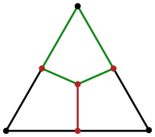
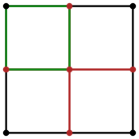
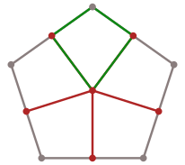
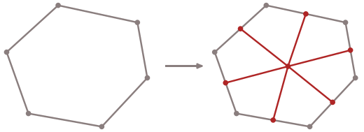
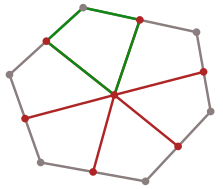

# FVMAdapt Geometric Splitting Reference {#fvmadapt_geometric_splitting}

Refinement divides a cell in local coordinates. Its geometry map places the
new points in physical space. Both neighbors use the same shared-face divisions
and accepted centers.

The figures use idealized reference shapes to expose topology. They do not
imply that physical mesh cells are regular or orthogonal. Local directions need
not align with physical axes.

The isotropic construction illustrated below is the `corner` split family:
one child surrounds each original vertex. The `native` patterns described
later use different children, even when they also split isotropically.

## Isotropic Face Splitting

The usual isotropic construction splits an n-edge face into n quadrilateral
children:

1. Split each boundary edge at its midpoint.
2. Create one face-center node.
3. Connect the face center to every edge midpoint.
4. Each original vertex forms one quadrilateral child face with the two
   adjacent edge midpoints and the face center.

### Triangle Face

The parent has three edges, so the split creates three quadrilateral children.
One child is highlighted below.

### Quadrilateral Face

The parent has four edges, so the split creates four quadrilateral children.
One child is highlighted below.

### Pentagon Face

The parent has five edges, so the split creates five quadrilateral children.
One child is highlighted below.

### General Polygonal Face

An n-edge parent produces n quadrilateral children. One child is highlighted
below.

## Isotropic Cell Splitting

After splitting the boundary faces, create one cell-center node and connect it
to every face center. One interior quadrilateral face is formed around each
original edge. The resulting children surround the original vertices, with
one child per vertex.

### Hexahedron

An isotropic hex split divides all three local directions and creates eight
hex children.

Each boundary face is split in both face-local directions. The
construction uses the edge midpoints, six face centers, and one cell center to
form the child connectivity. In the figure below, red points mark the inserted
edge-midpoint and face-center nodes, while the green point marks the cell
center. Red segments connect edge midpoints to face centers, and green segments
connect face centers to the cell center.

The animation separates the eight children.

### Tetrahedron

A tetrahedron produces four children with hexahedral connectivity.

The animation separates the four children.

### Triangular Prism

A triangular prism produces six children with hexahedral connectivity.

The animation separates the six children.

### Pyramid

A pyramid produces five children: four hexes at the base vertices and a
child with ten vertices and eight quadrilateral faces at the apex.

The animation separates the five children.

For a curved pyramid, the library makes these divisions in the original
pyramid's coordinates and maps them to physical space. The ten-vertex child
can be split again while retaining that map.

### General Cell Topology

Each original vertex produces one child whose shape depends on that vertex's
incident-edge count. One split can therefore produce children with different
shapes.

| Incident edges | Child nodes | Child edges | Child faces | Example |
| --- | --- | --- | --- | --- |
| 3 | 8 | 12 | 6 | Tetrahedron child or pyramid base-vertex child |
| 4 | 10 | 16 | 8 | Pyramid apex child |
| n | `2*n + 2` | `4*n` | `2*n` | General-cell child |

All child faces are quadrilateral. Only the three-edge case has hexahedral
connectivity: eight nodes and six quadrilateral faces. That topological
description does not imply right angles. The
[geometry description](@ref fvmadapt_reference_geometry) gives the requirements
on the source cell.

## Native Split Patterns

Standard elements also support cuts that preserve their shape or use a different
set of children. These need not produce the same mesh as the construction above.

| Parent | Available cuts and children |
| --- | --- |
| Hex | One cut in each of one, two or three local directions gives two, four or eight hexes |
| Triangular prism | Triangle subdivision and independent axial cuts give prism children |
| Tet | Edge bisection gives two tets; the eight-tet split has three central diagonal choices |
| Pyramid | Six pyramids and four tets; no directional split |

Triangle cuts include edge bisection and division into four triangles. These
also supply the prism's base subdivision. Directional cuts can be away from
the midpoint where supported.

Neighbors using different patterns match their face pieces in the original
face's local coordinates. Both sides use the resulting points and the same
saved face map.

## Straight 2D Meshes

The `extruded` family splits a planar triangle or quad first. The same
points are used on both end faces, preserving the extrusion thickness.
The triangle produces three quads and the quad produces four, each extended
through that thickness.

## Supported Geometry and Splits {#fvmadapt_geometry_support}

The [center methods](@ref fvmadapt_reference_geometry) are reference, weighted
and integrated. The table gives the allowed combinations for original cells;
nonstandard children retain their parent's geometry.

| Input cells | Cubic edge input | Split families | Center methods |
| --- | --- | --- | --- |
| 3D tets, prisms and hexes | Yes | `native`, `corner` | Native: reference; corner: all three |
| Pyramids | Yes | `native`, `corner` | Native: reference; corner: all three for straight edges, reference for curved edges |
| General polyhedra | No; straight edges only | `corner` | All three |
| Straight 2D hex/prism extrusions | No; straight edges only | `native`, `extruded` | Native: reference; extruded: all three |

The `mixed` family selects native hex/prism splits and corner splits for other
cells. It requires full 3D refinement, reference centers and midpoint cuts at
mixed interfaces. Source cells requiring piecewise face patches do not accept
curved edge input.

Accepted split points remain in the [history](@ref fvmadapt_plans_and_balancing)
for reuse after coarsening. A valid reference split does not by itself guarantee
good [physical cell geometry](@ref fvmadapt_reference_geometry).
