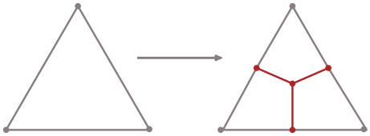
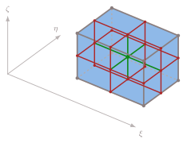
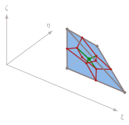
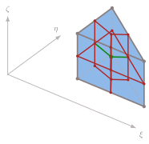
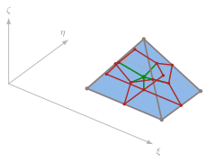

# Splitting Cells {#fvmadapt_geometric_splitting}

Refinement divides a cell in local coordinates. Its geometry map places the
new points in physical space. Both neighbors use the same shared-face divisions
and accepted centers.

The figures use idealized shapes to expose topology. They do not
imply that physical mesh cells are regular or orthogonal. Local directions need
not align with physical axes.

## Isotropic Face Splitting

The usual isotropic construction splits an n-edge face into n quadrilateral
children:

1. Split each boundary edge at its midpoint.
2. Create one face-center node.
3. Connect the face center to every edge midpoint.
4. Each original vertex forms one quadrilateral child face with the two
   adjacent edge midpoints and the face center.

A triangle produces three quadrilateral children:

A quadrilateral produces four:

The same construction applies to a polygon with more sides. This pentagon
produces five quadrilateral children:

## Isotropic Cell Splitting

After splitting the boundary faces, create one cell-center node and connect it
to every face center. One interior quadrilateral face is formed around each
original edge. The resulting children surround the original vertices, with
one child per vertex.

### Hexahedron

A hex produces eight hex children. Red segments connect edge midpoints to face
centers, and green segments connect face centers to the cell center.

### Tetrahedron

A tetrahedron produces four children with hexahedral connectivity.

### Triangular Prism

A triangular prism produces six children with hexahedral connectivity.

### Pyramid and General Cells

A pyramid produces five children: four hexes at the base vertices and a
child with ten vertices and eight quadrilateral faces at the apex.

A general cell uses the same construction on its bounding faces. The child's
shape depends on how many edges meet at its original vertex; it need not be a
standard element. The [geometry description](@ref fvmadapt_reference_geometry)
gives the requirements on the source cell.

The cell chooses a split; its faces and edges supply the matching divisions.
The library records the accepted points. Repeating a split after coarsening
reuses those points, even if the preferred center method has changed.

## Other Split Patterns

Standard elements also support cuts that preserve their shape or use a different
set of children. These need not produce the same mesh as the construction above.

| Parent | Available cuts | Center choice |
| --- | --- | --- |
| Hex | Cuts in selected local directions; three midpoint cuts give eight hexes | Cut positions define the split |
| Triangular prism | Triangle subdivision and independent axial cuts | Cut positions define the split |
| Tet | Edge bisection or eight tets; the latter has three central diagonal choices | Fixed pattern |
| Pyramid | Six pyramids and four tets | Fixed pattern; no directional split |

Triangle cuts include edge bisection and division into four triangles. These
also supply the prism's base subdivision. Directional cuts can be away from
the midpoint where supported.

For example, one midpoint cut across a hex produces two hexes. Cutting in two
local directions produces four; cutting in all three produces eight.
A prism can be cut along its axis independently of the cuts across its ends.

Neighbors using different patterns match their face pieces in the original
face's local coordinates. Both sides use the resulting points and the same
saved face map. The [interface reference](@ref fvmadapt_reference_subdivision)
lists the supported combinations and center choices.

## Straight 2D Meshes

For straight 2D meshes, the planar triangle or quad splits first. The same
points are used on both end faces, preserving the extrusion thickness.
The triangle produces three quads and the quad produces four, each extended
through that thickness.

A valid reference split does not guarantee good physical cells. Check mapped
geometry and output quality before accepting new constructions. See
[cell geometry](@ref fvmadapt_reference_geometry).
